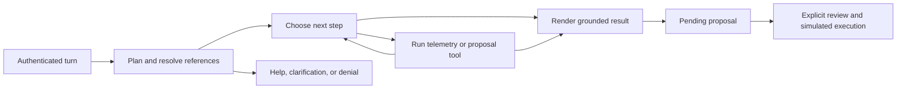

# Rayda Fleet Copilot

A telemetry-only assistant for IT administrators. It answers current-state questions, investigates trends, and drafts evidence-backed IT actions for explicit review. Python, LangGraph, and SQLite run locally.

## Run in five minutes

Use Python 3.11–3.14 and uv. The lock file covers the app and the development suite.

```sh
uv sync --locked
uv run python scripts/make_demo.py demo.ndjson
uv run fleet import demo.ndjson
export FLEET_TOKEN="$(uv run fleet user-add --tenant acme-001 --user reviewer)"
uv run fleet ask --trace "Which devices have low disk space?"
uv run fleet ask "Show the disk history for device DEMO-A over the past 7 days."
uv run fleet ask --trace "What about the other one?"
```

PowerShell uses `$env:FLEET_TOKEN = uv run fleet user-add --tenant acme-001 --user reviewer`. The demo fixture is synthetic. It has two Acme devices below the disk threshold, with seven days of data for DEMO-A and two for DEMO-B. All three commands share the default persisted conversation. Use `--session NAME` for a separate conversation or `fleet chat` for a continuous prompt.

For assessment-data evaluation, use the NDJSON supplied by the hiring team. Set `FLEET_DB` to a new local path, import it, and provision a token for a company listed in the import manifest. The fixture and official data should use separate databases. The assessment file stays local.

## Review a proposed action

```sh
uv run fleet ask --trace "Draft a ticket for failing screen_lock compliance checks."
uv run fleet proposal PROPOSAL_ID
uv run fleet approve PROPOSAL_ID
uv run fleet approve PROPOSAL_ID
uv run fleet audit PROPOSAL_ID
```

On the synthetic dataset this creates one proposed ticket for DEMO-A. The first approval creates a simulated work order. The second returns the same effect, and the audit shows one execution. Use `fleet reject PROPOSAL_ID` on a fresh proposal to test rejection. Chat can draft proposals. The authenticated CLI command carries human approval.

`fleet ask --json "…"` includes structured results, citations, and the execution trace. `fleet audit RUN_ID` retrieves the persisted trace. To inspect a citation, run `fleet evidence DEVICE_ID UTC_TIMESTAMP` using the two components shown in the result.

## Record handling when telemetry is delayed

```sh
uv run fleet ask "Show the disk status for DEMO-A."
uv run fleet ask "I already fixed it."
uv run fleet handled DEMO-A --metric disk --at 2026-06-12T13:00:00Z
uv run fleet ask "Show the disk status for DEMO-A."
uv run fleet handling DEMO-A
```

The conversation resolves the device and issue and asks for explicit confirmation. In `fleet chat`, an administrator can confirm with `/handled DEMO-A --metric disk --at 2026-06-12T13:00:00Z`. A compliance report also takes `--check-id`, for example `screen_lock`. The recorded time defaults to now. For earlier work, provide its actual time with `--at` and include a time zone. The fixture example records an event after its original noon snapshot. Run `uv run --locked python -m pytest -k reconciliation` to replay old and new snapshots out of order.

Handling reports are separate from snapshots and keyed to the tenant, device, metric, and compliance check where applicable. The current view can show `pending_verification`, `verified`, or `still_abnormal`. Verification compares the newest usable post-handling snapshot against the default policy for that issue. It uses the snapshot's collection time, including when snapshots arrive out of order. The original snapshot and the administrator's claim remain auditable. The report lists the baseline and any verification reference. While verification is pending, the same issue is held from new proposals and existing drafts cannot be executed. Other issues on the device can still be handled independently.

## Agent architecture



A typed plan carries the metric, latest/history strategy, window, filters, device reference, and requested action. The graph selects valid tools, records each decision and observation, and caps tool iterations. The tool allowlist enforces dependencies. When alternatives are available, the planner selects between them. For a current-then-history plan, a latest result with no candidates ends the turn; a non-empty result scopes history to those device IDs. The graph renders facts directly from validated tool results. The trace records decisions and data flow as structured events.

The conversation keeps the last displayed matching group, the focused device, and the last query. The CLI labels and numbers the exact device order used for ordinal follow-ups. Explicit IDs, ordinals, and references such as “the other one” are resolved against tenant-visible IDs. A targeted follow-up can change focus while preserving the group. Ambiguity leads to clarification.

### Tool catalog

| Tool | Inputs and output |
|---|---|
| `latest` | Typed metric, optional device IDs, platform, and metric-specific filters. Returns one latest snapshot per device, matching IDs, unknown IDs, and citations. |
| `history` | The same query plus a 2–30 UTC-day window. Returns daily coverage, matching days, compliance transitions, and snapshot citations. |
| `propose` | A requested action and same-turn evidence. Persists immutable pending tickets for current compliance failures or sustained disk/RAM pressure, and replacement-review requests for sustained battery service conditions. |
| `approve`, `reject` | Authenticated CLI operations on one proposal ID. Approval verifies the exact proposal and evidence, then writes one simulated effect. |

### Grounding policy

- The dataset's latest tenant snapshot is the as-of time. Each device's latest snapshot is selected independently. Latest readings older than 48 hours relative to that anchor are stale. The CLI counts stale or missing measurements separately from matched devices and labels them per device.
- Laptop and desktop filters use the latest snapshot's form factor or model. Unclassified hardware is reported separately. Re-import the original NDJSON to enrich databases created by the first revision.
- Disk uses the system volume (`/` on macOS/Linux, `C:\` on Windows) and defaults to under 10% free. RAM defaults to at least 85% reported used; this is a utilization signal. Explicit comparisons preserve the requested direction. Ask about percent free for disk and percent used for RAM. OS version filters compare numeric segments within the requested platform.
- History takes the latest sample per UTC date. Requests for a named date are directed to a rolling window. It covers the requested number of dates ending on the as-of date. Persistence needs coverage of at least 70% of days (and at least three observed days) and a threshold breach on at least 70% of calendar days. Compliance history also reports a check moving from first-observed pass to last-observed fail, or vice versa, with sufficient coverage. Battery reports recorded service conditions and available measurements. Missing battery telemetry is unknown.
- Evidence references pair a device ID with its exact normalized UTC timestamp. Current results cite the examined snapshots, including empty-match queries. Trend results show measurement coverage, findings, and examined snapshots. Actions bind evidence to a device and a specific check or policy.

### Guardrails and trade-offs

The CLI is a local application with an OS-trusted ingestion/provisioning boundary. A reviewer token binds company, actor, and role. Queries, evidence, conversations, and proposal access use that identity; prompts and planner outputs cannot grant scope. Viewers may query but cannot propose or approve. The SQLite file belongs to the trusted operator; a deployed service would keep it behind an authenticated boundary.

Proposal creation requires an explicit affirmative request and rechecks current evidence. A request with an unsupported condition stays read-only and gets a clarification. The supported conditional form is a single comparison on free disk space or used RAM. Use the English action examples as the supported request vocabulary. Location and employee-assignment filters require an additional data source. Explicit device IDs and OS version filters remain in scope through the proposal and approval. Identical pending proposals are reused for the same tenant and evidence. Read queries may use exploratory thresholds. Requests matching more than ten proposals must be narrowed before drafting. Disk/RAM tickets apply the action policy threshold or a stricter threshold and require a current match plus sustained history. Battery requests create an IT review, using a current service indication plus sustained history. Approval checks the stored payload digest, the current evidence references, and the administrator role. If the cited evidence changes, the proposal expires and must be regenerated. The simulated effect and its review events commit together. A unique proposal key and transactional review make duplicate approval idempotent. There is no write access to devices or integration with vendor systems.

The offline planner is a small English-first parser for reproducible examples. The model planner handles broader paraphrases against the same typed contracts. Model mode sends the request, explicit device references, the selected conversation context, and compact observation summaries to the configured endpoint. The data is structured and small, so parameterized SQLite plus Python calculations keep evidence selection and policy inspectable. The demo keeps operator setup and approval in the CLI; sessions survive restarts at completed-turn boundaries.

## Evaluation

```sh
uv run --locked python -m pytest -q
# Optional assertions against the actual assessment file:
FLEET_ASSESSMENT_DATA=/path/to/device-telemetry-dataset.ndjson uv run --locked python -m pytest -q
```

In PowerShell set `$env:FLEET_ASSESSMENT_DATA = 'path-to-file'` before running pytest. Tests check tool paths conditioned on observations, multi-turn ID resolution, evidence and expected counts, tenant boundaries, missing coverage, concurrent approval, rejection, and proposal expiry. The optional official-data case checks data shape and tenant-scoped counts. Expectations are specified separately from the runtime query functions.

### Model providers

[Copy the model profile template](config/models.example.toml) to `fleet.models.toml` or pass the path explicitly. Profiles hold the provider, model ID, optional base URL, timeout, retry limit, and the environment variable name for the credential. Keep credential values in the environment. The copy named `fleet.models.toml` is ignored by Git. Select a profile with `--model-profile` or `RAYDA_MODEL_PROFILE`. Use `--model-config` or `RAYDA_MODEL_CONFIG` for a different file. Without a TOML file, the original provider environment variables remain supported. Model IDs in the example are editable. Use an ID available on your account.

```sh
# Set OPENAI_API_KEY, DEEPSEEK_API_KEY, MIMO_API_KEY, ANTHROPIC_API_KEY, or GOOGLE_API_KEY in your environment first.
uv run fleet ask --backend model --model-config config/models.example.toml --model-profile openai --trace "Which devices have low disk space?"
uv run --locked python -m scripts.model_eval --model-config config/models.example.toml --model-profile deepseek
uv run --locked python -m scripts.model_eval --model-config config/models.example.toml --model-profile mimo-api
uv run --locked --extra native-models python -m scripts.model_eval --model-config config/models.example.toml --model-profile gemini
```

The live suite uses synthetic telemetry and the selected model endpoint. Hosted inference requires an application-authorized API credential for that endpoint. The Xiaomi example uses the standard application API and its own key. The DeepSeek example targets the official Chat Completions endpoint, reads `DEEPSEEK_API_KEY`, and uses a bounded JSON planner response with thinking disabled. The graph uses the same typed plan and decision contracts across providers.

| `RAYDA_PROVIDER` | Configuration |
|---|---|
| `openai-compatible` (default) | Use `OPENAI_API_KEY` or `RAYDA_API_KEY` for OpenAI. For a custom endpoint, set `RAYDA_BASE_URL` and that endpoint's `RAYDA_API_KEY`. The API must implement Chat Completions with JSON object output. |
| `anthropic` | Install `uv sync --locked --extra native-models` and set `ANTHROPIC_API_KEY`. |
| `google_genai` | Install `uv sync --locked --extra native-models` and set `GOOGLE_API_KEY`. |

The native Anthropic and Gemini adapters pin their official HTTPS endpoints. Gemini uses the Gemini Developer API. Unset `GOOGLE_GENAI_USE_VERTEXAI` and `GOOGLE_GENAI_USE_ENTERPRISE` or set them to `false` for this profile. Set a custom base URL only for an OpenAI-compatible profile. The native adapters use LangChain's `init_chat_model` with provider-specific structured output. Run the live checks with the provider extra if applicable (`uv run --locked --extra native-models python -m scripts.model_eval`). Use a credential authorized for application inference and keep it in your process environment.

```sh
uv run fleet ask --backend model --trace "Which devices consistently have little disk space?"
uv run --locked python -m scripts.model_eval
```

### Local live evaluation

The model endpoint can be a loopback-only llama.cpp server. One reproducible setup is
[llama.cpp b12024](https://github.com/ggml-org/llama.cpp/releases/tag/b12024) and the official
[Qwen3-4B Q4_K_M model](https://huggingface.co/Qwen/Qwen3-4B-GGUF). The model file's SHA-256 is
`7485fe6f11af29433bc51cab58009521f205840f5b4ae3a32fa7f92e8534fdf5`.

```sh
llama-server -m /path/to/Qwen3-4B-Q4_K_M.gguf --host 127.0.0.1 --port 18478 --alias qwen3-4b-q4km --reasoning off --ctx-size 4096 --parallel 1 --temp 0
export RAYDA_LOCAL_API_KEY=local-demo-placeholder
uv run --locked python -m scripts.model_eval --model-config config/models.example.toml --model-profile local-qwen
```

The placeholder is for an unauthenticated loopback server. Use the real provider's own credential for a hosted endpoint.
PowerShell can set the same variables with `$env:NAME = 'value'`.

The live suite uses a fresh synthetic database and reports the chosen model, case outcomes, and traces. It checks paraphrased queries, a follow-up, missing evidence, cross-company scope, and action proposal creation. The offline suite verifies application behavior and policy invariants. Model behavior is measured by the live suite and can vary across providers and versions.
